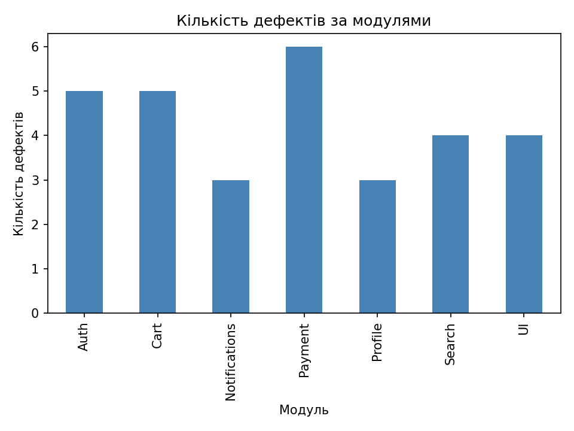

# Аналіз дефектів програмного проєкту

## Опис проєкту
Навчальний аналіз набору даних про дефекти в Python (pandas, matplotlib).

## Структура репозиторію
- `notebooks/` — notebook з аналізом (`lab_analysis.ipynb`)
- `data/` — навчальний набір даних (`bugs.csv`)
- `docs/` — діаграми та документи (`chart.png`)

## Як запустити
1. Натисніть кнопку **Open in Colab**.
2. Виконайте **Runtime → Run all** (**Среда выполнения → Выполнить все**).

## Дані
Набір навчальний, синтетичний (30 записів): `id`, `module`, `severity`, `status`, `hours_to_fix`.

## Результати

## Автор
Андрейчук Арсеній Ярославович, група ПІ-25-01
